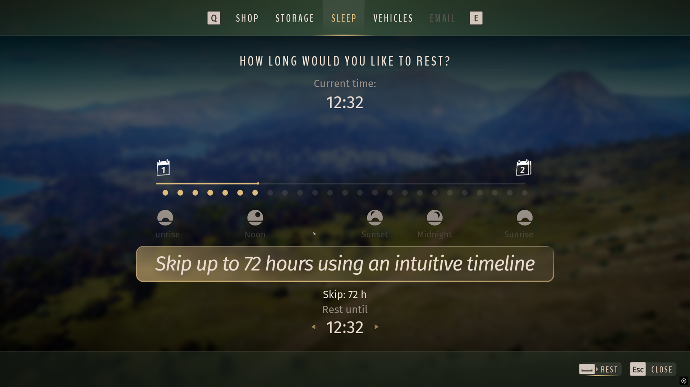
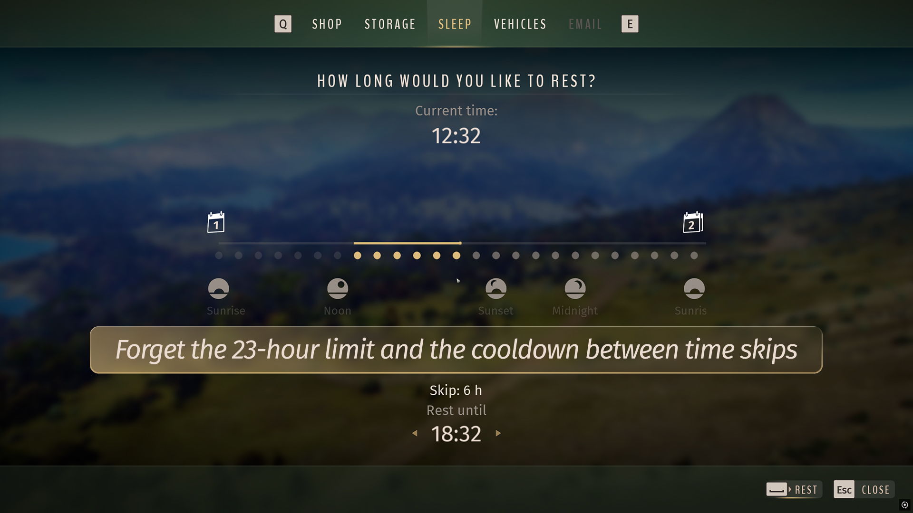
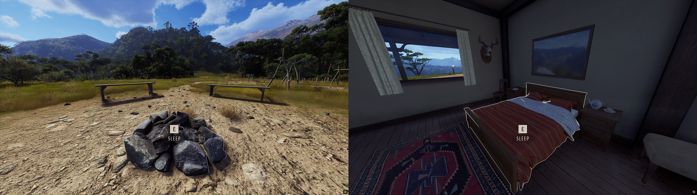

# 72-Hour Sleep — Way of the Hunter Mod

Sleep for up to 72 hours at a time in Way of the Hunter and repeat sleep without active-play requirements to skip unlimited in-game time.

## Overview

Waiting for the right hunting period or advancing the animal population can involve many short sleeps and required time spent actively playing between them. **72-Hour Sleep makes long skips easier:** **select up to three days** on a clear timeline, then sleep again immediately. The normal animal update cycle remains active, so repeated sleep can advance **unlimited in-game time without active gameplay between rests.**

## Download & Install

You can download the mod from my [Website](https://mahpella.com/games/way-of-the-hunter/mods/sleep-timeline) or [Nexus Mods](https://www.nexusmods.com/wayofthehunter/mods/38).

### Step 1. Create a backup (optional)

If you wish, copy the **Saved** folder to another location:  
**Win + R → `%LOCALAPPDATA%\WayOfTheHunter`**

### Step 2. Open the game folder

Close the game. In Steam, browse the local files for Way of the Hunter and open:  
`WayOfTheHunter\Content\Paks`

### Step 3. Install the mod

Extract the archive and copy all **.pak files into the Paks folder**, replacing older versions if necessary.  
Launch the game and load your save.

## How to Use

- Open the **sleep menu**.
- Click the timeline or hour dots to choose **between 1 and 72 hours**.

- Drag with the left mouse button or scroll to browse; each wheel step moves the visible window by three hours.
- Use the arrows to change the duration by one hour; hold an arrow to repeat.
- **Repeat sleep as often as needed.** No active-playtime interval is required between sleeps, and normal three-day animal updates remain active.

> Use this mod with caution! Skipping large amounts of time without considering the consequences can reduce population quality and undo your herd management progress across the map.

## Best Mod Combos

To make 72-Hour Sleep lead into the hunt you want, I recommend two additions for choosing the time and destination.

1. [Herd Tracker](https://www.nexusmods.com/wayofthehunter/mods/28) — check the relevant species’ schedule and decide which activity period you want to wake for. Then choose your sleep duration on the timeline.
2. [Better Need Zones](https://www.nexusmods.com/wayofthehunter/mods/31) — after waking, check the suitable zones and follow a marker you have already placed. Time skipping then leads into your planned hunt instead of another search for a location.

## Feedback

If you find a bug, have suggestions for improving this mod, or have ideas for new mods, I would love to hear from you.

More useful interface and UX mods at my website: [mahpella.com](https://mahpella.com).

If you would like to support my work →  
[Buy Me a Coffee](https://buymeacoffee.com/mahpella) or [PayPal.me](https://paypal.me/bymahpella).

